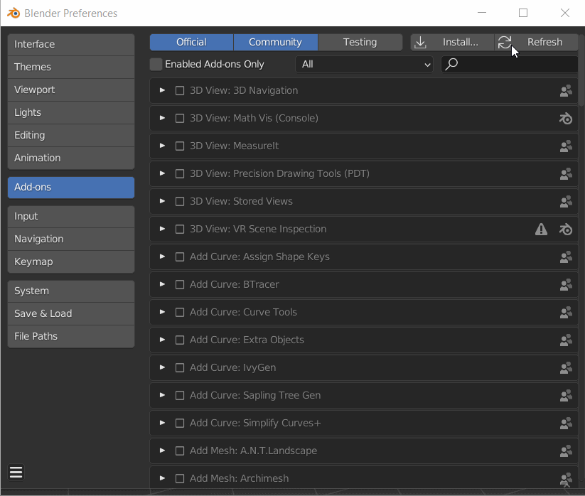

# Download e installazione del plug-in

## Scarica

Per scaricare il plug-in, visita [Substance 3D in Blender](https://substance3d.adobe.com/plugins/substance-in-blender/). Fai clic su **Scarica il plug-in** per avviare il download.

Puoi anche ottenere la versione più recente direttamente dai collegamenti seguenti.

Sono disponibili due file .zip separati da scaricare e installare:

* Componente aggiuntivo Substance 3D per Blender ([download singolo per tutte le piattaforme](https://www.adobe.com/go/substance3d-blender-multi-latest))
* Strumenti di integrazione Substance 3D (scaricare [Windows](https://www.adobe.com/go/substance3d-integrationtools-win-latest), [Mac](https://www.adobe.com/go/substance3d-integrationtools-mac-latest) o [Linux](https://www.adobe.com/go/substance3d-integrationtools-lin-latest) versioni)

>[!WARNING]
>
> **Per gli utenti di Mac:** *Se stanno scaricando il plug-in con Safari, gli utenti devono disattivare &quot;Apri file sicuri dopo il download&quot;.*
>
> Per impostazione predefinita, il browser Web Safari decomprime i file .zip scaricati, che devono rimanere compressi per l’installazione. Per evitare che il file venga decompresso, aggiorna le preferenze di Safari per non aprire i file &quot;sicuri&quot; dopo il download.
>
> 1. Apri Safari
> 1. Fai clic su **Preferenze**
> 1. Nella scheda Generale deselezionare l&#39;opzione **Apri file &quot;sicuri&quot; dopo il download.**

## Procedura di installazione

### Prima installazione

1. Scarica i file .zip del plug-in dalla pagina prerelease di Adobe.
1. Apri Blender (v. 3.0 o superiore).
1. Nella barra di navigazione superiore, seleziona Modifica e quindi Preferenze. Quindi seleziona la scheda Componenti aggiuntivi.
1. Fai clic sul pulsante **Installa**.
1. In Esplora file, individua la cartella in cui sono stati scaricati i file .zip.
1. Seleziona il file Substance3DInBlender.zip e fai clic sul pulsante **Installa componente aggiuntivo**.
1. Nella sezione Componenti aggiuntivi, fai clic sulla casella di controllo per abilitare il componente aggiuntivo, quindi fai clic sulla freccia a discesa per espandere la sezione.
1. Verrà richiesto di installare gli Strumenti di integrazione. Fare clic su **Installa dal disco** per selezionare **Substance3DIntegrationTools.zip** e fare clic sul pulsante **Installa strumenti**.\
   Se non sono stati scaricati in precedenza, fai clic su **Scarica** per aprire la pagina prerelease di Adobe nel browser e scaricare gli strumenti, quindi utilizza **Installa dal disco** per installarli.
1. Il componente aggiuntivo è ora pronto per l’uso.

### Aggiornamento del plug-in e degli strumenti

1. Scarica la versione più recente dai collegamenti precedenti.
1. Utilizzare il pulsante **Disinstalla strumenti** per rimuovere gli strumenti di integrazione di Substance 3D.
1. Utilizza il pulsante **Rimuovi** per disinstallare il componente aggiuntivo
1. Chiudi e riavvia Blender
1. Nella barra di navigazione superiore, seleziona Modifica e quindi Preferenze. Quindi seleziona la scheda Componenti aggiuntivi.
1. Fai clic sul pulsante **Installa**.
1. In Esplora file, individua i file ZIP scaricati di recente.
1. Seleziona il file Substance3DInBlender.zip e fai clic sul pulsante del componente aggiuntivo **Installa**.
1. Nella sezione Componenti aggiuntivi, fai clic sulla casella di controllo per abilitare il componente aggiuntivo, quindi fai clic sulla freccia a discesa per espandere la sezione.
1. Verrà richiesto di installare gli Strumenti di integrazione. Fai clic su **Installa dal disco** per selezionare Substance3DIntegrationTools.zip e fai clic sul pulsante **Installa strumenti**.\
   Se non sono stati scaricati in precedenza, fai clic su **Scarica** per aprire la pagina prerelease di Adobe nel browser e scaricare gli strumenti, quindi utilizza **Installa dal disco** per installarli.
1. Il componente aggiuntivo è ora pronto per l’uso.

### Aggiornamento di singoli componenti

Quando si aggiorna solo il componente aggiuntivo:

1. Nelle preferenze del componente aggiuntivo, utilizza il pulsante **Rimuovi** per disinstallare il componente aggiuntivo.
1. Riavvia Blender
1. Passa nuovamente alle preferenze del componente aggiuntivo e usa il pulsante **Installa** per caricare la nuova versione del plug-in. Gli Strumenti di integrazione caricati in precedenza rimarranno invariati.

Quando si aggiornano solo gli strumenti di integrazione:

1. Nelle preferenze del componente aggiuntivo, utilizzare il pulsante **Strumenti di aggiornamento** per caricare la versione più recente degli strumenti di integrazione. Il componente aggiuntivo utilizzato in precedenza rimarrà attivo.
1. Per rendere effettive le modifiche, riavvia Blender.

OPPURE

1. Nelle preferenze del componente aggiuntivo, utilizza il pulsante **Disinstalla strumenti** per rimuovere gli strumenti di integrazione.
1. Riavvia Blender
1. Utilizzare il pulsante **Installa dal disco** per trovare e caricare la versione più recente degli strumenti di integrazione. Il componente aggiuntivo utilizzato in precedenza rimarrà attivo.