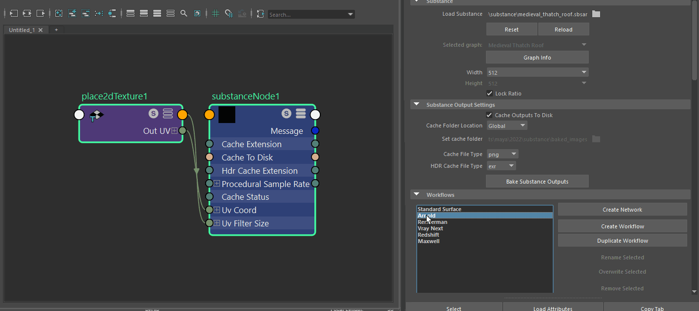

# Panoramica di Substance in Maya

## Panoramica del plug-in

Il plug-in Substance per Maya consente di caricare qualsiasi materiale Substance 3D esistente (file .SBSAR) direttamente in Maya. I materiali Substance 3D possono essere creati ed esportati come file SBSAR da Substance 3D Designer o Substance 3D Sampler e scaricati dalle librerie esistenti come la libreria Substance 3D Assets. La Substance per il plug-in Maya crea materiali Maya e alimenta le texture di output nei corretti ingressi del canale di materiale

>[!NOTE]
>
> Assicurati che il plug-in sia caricato in Impostazioni/Preferenze ->Gestione dei plug-in Maya

## Apertura di un file SBSAR nell&#39;editor dei nodi Hypershade

1. Aprite **Hypershade** e nell&#39;**Editor nodi**, fate clic con il pulsante destro del mouse e scorrete verso l&#39;alto nel menu di contrassegno per scegliere **Crea nodo**. Nella finestra **Crea nodo**, cercare e selezionare il **nodo Substance**.

   

   Fare clic sul **nodo Substance** in Hypershade per selezionarlo. Verrà aperto **Editor materiale**, in cui è possibile caricare il materiale Substance 3D (file SBSAR) facendo clic sull&#39;icona della cartella.

1. In alternativa, puoi trascinare un file SBSAR nell&#39;**Editor Hypershade** di Maya e fare clic sul nodo Substance creato automaticamente per visualizzare e modificare direttamente le opzioni in **Editor materiali**.

### Riproduci con i parametri SBSAR nell&#39;Editor proprietà

1. Il menu a discesa **Grafico selezionato** viene compilato se la Substance contiene più grafici. Selezionate il grafico da utilizzare per creare il materiale.

1. Il **pulsante Informazioni grafico** visualizza gli attributi del grafico impostati in Substance Designer.

1. Impostate la risoluzione impostando i valori **Larghezza** e **Height**. Disattivate **Blocca proporzioni** per scegliere proporzioni non quadrate.

1. Abilita **Uscite cache su disco** per eseguire i baking gli output della Substance su disco in modo che possano essere utilizzati con renderer come Arnold. Il file memorizzato nella cache verrà riletto dal plug-in utilizzando un nodo di file Maya.

   

1. Scegli un flusso di lavoro per il modulo di rendering in uso e fai clic sul pulsante **Crea rete a Shader**. Viene creata una rete di shader per il flusso di lavoro del modulo di rendering. Per le versioni 3.1.1., l’elenco dei flussi di lavoro offre anche l’opzione per la creazione di reti di shader di OpenPBR. Una volta creata la rete di shader, puoi applicare il materiale nella scena.

   {width="1000px"}

## Risoluzione dei problemi

Per segnalare un bug, partecipa al canale #maya-plugin sul [server Discord Substance](https://discord.com/invite/substance3d) o visita le [community di Adobe](https://community.adobe.com/t5/substance-3d-plugins/ct-p/ct-substance-3d-plugins?page=1&sort=latest_replies&lang=all&tabid=all&topics=label-autodesk3dsmax). L&#39;inclusione di informazioni rilevanti dal registro della console e da eventuali passaggi di riproduzione ci aiuterà a diagnosticare il problema in modo più efficiente.